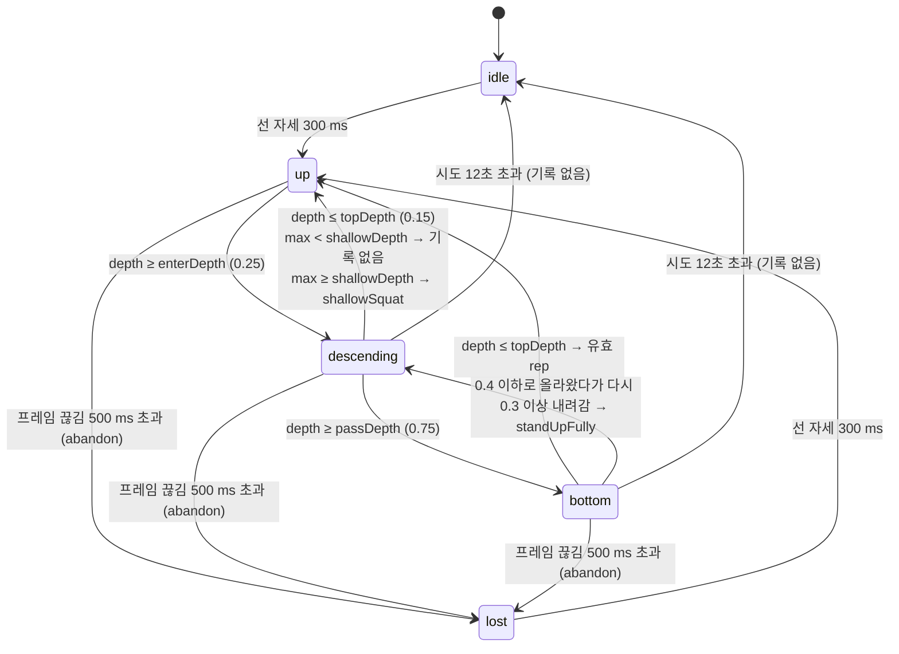
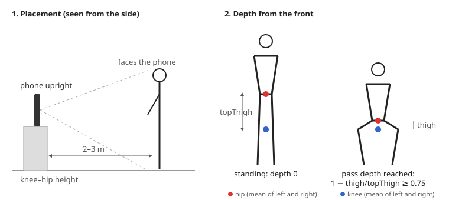

# GymRats Iteration 3 스쿼트 판정기와 공통 판정기 인터페이스 설계 (P5)

상태: 제안 v0.1 / 작성일: 2026-10-28 / 작성: 한상우 / 구현: S2 `feat/squat_judge`, 배틀 연결: S4 `feat/squat_battle`

스쿼트를 두 번째 운동으로 넣기 전에, 판정기를 운동별로 갈아 끼우는 공통 인터페이스(`ExerciseRepJudge`)와 스쿼트 판정 규칙을 정한다. 이 문서의 목적은 송우현(W)과 송현우(H)가 "자기 파일을 바꾸지 않아도 된다"는 것을 확인하고(S4가 승인받아 대신 고칠 세 곳은 6.4), S2가 그대로 구현할 수 있게 하는 것이다. 이번 반복은 대략적인 첫 버전이며 정확도 목표는 없다(스쿼트 정확도는 Iteration 4).

## 1. 한눈에 보기

| 항목 | 결정 | 상태 |
|---|---|---|
| 촬영 방향 | **정면**. 폰을 세워 사용자 앞 2~3 m, 전신(머리~발목)이 보이게 | 제안 (OPEN, 3장) |
| 시작 자세 | 똑바로 선 자세 300 ms 유지 | 제안 |
| 깊이 기준 | 엉덩이(hip)와 무릎(knee)의 세로 거리. 선 자세의 허벅지 길이로 나눔 | 제안 |
| 깊이 값 | 0 = 선 자세, 1.0 = 엉덩이가 무릎 높이(평행), 1보다 크면 평행보다 깊음 | 제안 |
| 통과 깊이 `passDepth` | 0.75 (허벅지가 수평보다 약 15° 위) | 제안 (실측 필요) |
| 거절 사유 | `shallowSquat`(덜 앉음), `standUpFully`(덜 일어남). 폰 흔들림은 기존 `phoneMoved` | 제안 |
| 인터페이스 | `ExerciseRepJudge` + `judgeFor()` (4장, task.md 계약 그대로) | 확정 (계약) |
| 푸시업 | `PushUpJudgeAdapter`가 `RepJudge`를 감싸기만 함. `rep_judge.dart` 수정 없음 | 확정 (계약) |
| 게임 점수 | W3 게임 계층은 `RepEvent`와 `counter.passDepth`(4.1)만 읽으므로 스쿼트도 그대로 동작 | 확정 (계약) |
| W3 파일 세 곳 | W3는 바꾸지 않는다. S4가 소유권 예외 승인을 받아 R1~R3을 넣음: 스쿼트면 푸시업 리포트를 만들지 않음(봇·온라인), 배틀 데모는 푸시업 이유만 (6.4) | 결정 (사용자 2026-10-28) |
| 정확도 | 목표 없음. 통과 깊이와 임계값은 S2 데모로 대략 맞춤 | 확정 (브리프 §2) |

## 2. 스쿼트 동작과 측정

### 2.1 랜드마크

ML Kit 33개 랜드마크 중 다음만 쓴다. 좌우 둘 다 보이면 평균, 한쪽만 보이면 그쪽 값을 쓴다. `minLikelihood`(0.6) 미만은 안 보이는 것으로 본다.

| 용도 | 랜드마크 |
|---|---|
| 깊이 | `leftHip`/`rightHip`, `leftKnee`/`rightKnee` |
| 선 자세 확인 | 위 둘 + `leftAnkle`/`rightAnkle`, `leftShoulder`/`rightShoulder` |
| 정면 확인(설정 단계) | `nose`, `leftEye`, `rightEye`, 어깨 (기존 `SetupChecker` 그대로) |

### 2.2 깊이 (depth)

```
thigh(t)   = kneeY(t) − hipY(t)                 // 이미지 y는 아래로 증가, 픽셀
topThigh   = 선 자세에서 잰 thigh (기준값)
depth(t)   = 1 − thigh(t) / topThigh
```

- 선 자세: 엉덩이가 무릎보다 허벅지 길이만큼 위 → `depth ≈ 0`.
- 평행 스쿼트: 엉덩이가 무릎 높이 → `depth = 1.0`.
- 엉덩이가 무릎보다 아래(깊은 스쿼트) → `depth > 1`.
- 하프 스쿼트(허벅지 45°): `1 − sin 45° ≈ 0.29`.

**왜 이 방식인가**

- 정면에서는 무릎 각도(hip–knee–ankle)가 원근 때문에 거의 180°로 보여서 쓸 수 없다. 반면 엉덩이와 무릎의 **세로** 거리는 정면에서도 그대로 줄어든다.
- 같은 프레임의 엉덩이와 무릎 차이를 쓰므로, 폰이 조금 움직이거나 사용자가 앞뒤로 반 걸음 움직여도 깊이가 덜 흔들린다(둘이 같이 움직임). 푸시업처럼 "기준점에서 얼마나 내려왔나"가 아니다.
- 단위가 "허벅지 길이"라서 키·거리와 무관하고, 1.0이 "평행"이라는 뜻이 분명하다.
- 푸시업과 단위는 다르다(푸시업은 어깨너비 단위 머리 하강). 그래서 게임 계층은 절대값이 아니라 `passDepth` 배수로만 비교한다(배틀 규칙 문서의 Excellent = `maxDepth ≥ 1.6 × passDepth`). 스쿼트 Excellent는 `1.6 × 0.75 = 1.2`, 엉덩이가 무릎보다 허벅지의 20% 아래로 내려간 깊은 스쿼트다.

`topThigh`는 선 자세가 유지될 때 잡고, 이후 시도가 열리기 전(`depth < enterDepth`, 푸시업 `_followTop`과 같은 조건)에 `baselineTau`(500 ms)로 천천히 따라간다. 거리가 바뀌어도 기준이 맞춰진다.

### 2.3 선 자세 (시작 자세)

아래가 모두 참인 프레임이 `topHold`(300 ms) 동안 이어지면 선 자세다.

1. 엉덩이·무릎·발목이 보인다.
2. 위에서부터 엉덩이 < 무릎 < 발목 순서(y 기준).
3. 허벅지가 펴져 있다: `thigh ≥ standingRatio × shin` (`shin = ankleY − kneeY`, `standingRatio = 0.7`). 사람 허벅지와 정강이는 길이가 비슷해서, 선 자세에서 이 비율은 약 0.9~1.1이다.
4. 상체가 서 있다: 어깨가 보이면 `torsoDropOf(...) ≥ 1.8`(어깨–엉덩이 세로 거리가 어깨너비의 1.8배 이상, `pose_metrics.dart`의 기존 함수 재사용). 송현우의 측정(`fix/pushup_judge_accuracy`)에서 플랭크 상단은 1.05~1.22(한 번 1.54), 선 자세는 2 이상이었다. 어깨가 안 보이면 이 조건은 건너뛴다.

### 2.4 상태 머신

푸시업과 같은 `RepPhase`를 그대로 쓴다(값의 뜻만 스쿼트에 맞게 읽는다).



| 상수 (`SquatJudgeConfig`) | 제안값 | 뜻 |
|---|---|---|
| `minLikelihood` | 0.6 | 푸시업과 같음 |
| `topHold` | 300 ms | 선 자세 유지 시간 |
| `standingRatio` | 0.7 | 2.3의 3번 |
| `uprightTorsoDrop` | 1.8 | 2.3의 4번 |
| `enterDepth` | 0.25 | 시도 시작 |
| `topDepth` | 0.15 | 다시 선 자세 |
| `shallowDepth` | 0.45 | 이보다 얕게 돌아오면 무릎 굽힘/흔들림으로 보고 기록하지 않음 |
| `passDepth` | 0.75 | 바닥(유효 깊이). 인터페이스의 `passDepth` |
| `partialDepth` | 0.4 | 바닥 뒤 여기까지만 올라왔다가 |
| `reDescentDepth` | 0.3 | 이만큼 다시 내려가면 `standUpFully` |
| `noiseFloor` | 200 ms | 이보다 짧은 시도는 기록 없음 (스쿼트는 푸시업보다 느리므로 100 → 200) |
| `maxFrameGap` | 500 ms | 쓸 수 있는 프레임이 이만큼 없으면 `abandon()` |
| `maxAttempt` | 12 s | 열린 시도 최대 길이 |
| `smoothingTau` | 65 ms | 엉덩이·무릎 y 지수 평활 |
| `baselineTau` | 500 ms | `topThigh`가 따라가는 속도 |

엉덩이나 무릎이 안 보이는 프레임은 깊이가 없으므로 상태를 바꾸지 않는다(푸시업에서 코가 안 보이는 프레임과 같음). 시간 처리(`maxFrameGap`, `maxAttempt`, `noiseFloor`)는 푸시업 판정기와 같은 규칙이다.

### 2.5 유효/거절 규칙

| 결과 | 조건 | `RejectReason` | 영어 `message` | 한국어 (`koreanMessage`) |
|---|---|---|---|---|
| 유효 | `passDepth`에 도달한 뒤 `topDepth` 이하로 일어남 | – | – | – |
| 거절 | `shallowDepth ≤ maxDepth < passDepth`로 일어남 | `shallowSquat` | `Sit lower` | `엉덩이를 무릎 높이까지 내려요` |
| 거절 | 바닥 뒤 끝까지 안 일어나고 다시 앉음 | `standUpFully` | `Stand up tall` | `끝까지 일어나요` |
| 거절 | 라운드 중 폰이 기울거나 흔들림 (기존 `rejectIfPhoneMoved`, 운동 무관) | `phoneMoved` | 기존 | `폰을 고정해 주세요` (기존) |
| 기록 없음 | `maxDepth < shallowDepth`, 200 ms 미만, 12초 초과, 프레임 끊김 | – | – | – |

- 무릎 모임(valgus), 상체 과다 숙임, 뒤꿈치 들림은 이번 반복에서 **거절하지 않는다**. 정면에서 상체 숙임과 뒤꿈치는 잘 안 보이고, 무릎 모임은 오판정 위험이 커서 Iteration 4의 경기 후 피드백 후보로 남긴다.
- 스쿼트 `RepEvent` 값: `maxDepth` = 시도 중 최대 depth(2.2의 단위), `descent` = 시도 시작부터 처음 `passDepth`에 도달할 때까지, `minElbowAngle`과 `maxTilt`는 `null`(필드 변경 없음).
- 스쿼트 `JudgeSnapshot`: `phase`, `depth`만 채운다. `elbowAngle`, `tilt`, `shoulderDrop`, `topShoulderY`는 `null`. 푸시업용 가슴 높이 안내선(`topShoulderY`)은 스쿼트에서 그리지 않는다(S4).

### 2.6 `RejectReason` 추가와 `forExercise`

`rep_event.dart`에는 **끝에 값 두 개와 정적 메서드 하나(와 `exercise_type.dart` import)만** 추가한다. `RepEvent` 필드는 바꾸지 않는다.

```dart
enum RejectReason {
  // ... 기존 9개 그대로 ...
  phoneMoved('Hold the phone still'),

  /// The hips came back up before reaching the pass depth.
  shallowSquat('Sit lower'),

  /// After the bottom, the user sat down again without standing up.
  standUpFully('Stand up tall');

  // ...

  /// Reasons a judge or a bot may give for [exercise]. Push-up battles never
  /// show squat reasons, and the other way round. [phoneMoved] is in both.
  static List<RejectReason> forExercise(ExerciseType exercise) => switch (exercise) {
    ExerciseType.pushUp => const [insufficientDepth, incompleteExtension,
        shouldersNotLevel, tooFast, kneesDown, armsStraight, bellyDown,
        notFloorPushUp, phoneMoved],
    ExerciseType.squat => const [shallowSquat, standUpFully, phoneMoved],
  };
}
```

| 새 값 | 와이어 코드 (`battleReasons`, `online_battle_session.dart`) |
|---|---|
| `shallowSquat` | `shallow_squat` |
| `standUpFully` | `stand_up_fully` |

기존 이유는 이름·순서·와이어 코드가 그대로라서, 저장된 경기 기록(`RepRecord.fromJson`은 이름으로 읽음)과 온라인 프로토콜이 깨지지 않는다.

## 3. 촬영 방향 제안 (OPEN): 정면

| 기준 | 정면 (제안) | 측면 |
|---|---|---|
| 깊이 측정 | 엉덩이–무릎 세로 거리로 충분 (2.2) | 무릎 각도를 바로 잴 수 있어 더 정확 |
| 양다리 인식 | 두 다리가 다 보여 ML Kit 신뢰도가 높음 | 먼 쪽 다리가 가려져 신뢰도가 자주 떨어짐 |
| 설정 확인 | 기존 `SetupChecker`의 정면 확인(코·눈·어깨)을 그대로 씀 | 정면 확인을 운동별로 끄고 측면 확인을 새로 만들어야 함 |
| 사용자 안내 | 푸시업과 같은 "카메라를 보세요" 흐름 | 운동마다 다른 방향을 설명해야 함 |
| 나중 피드백 | 무릎 모임이 보임 | 상체 숙임·뒤꿈치가 보임 |

**제안: 정면.** 이번 반복은 정확도 목표가 없는 첫 버전이고, 설정 단계와 안내를 푸시업과 공유할 수 있으며, 두 다리가 다 보여 인식이 안정적이다. 측면의 정확도 장점은 Iteration 4에서 실측과 함께 다시 본다.



**배치:** 폰을 세로로, 바닥에서 60° 이상 세워(기존 `phoneTooFlat` 검사 그대로) 사용자 앞 약 2~3 m에 둔다. 무릎~엉덩이 높이(의자, 선반)에 두면 원근 왜곡이 가장 적다. 머리부터 발목까지 화면 안에 들어와야 한다.

**`SetupChecker` 스쿼트 규칙 (S2):**

| 순서 | 검사 | 스쿼트 | 푸시업 (기존) |
|---|---|---|---|
| 1 | 폰 기울기·흔들림 | 같음 | 같음 |
| 2 | 사람 없음 / 너무 가까움 / 너무 멂 | 같음 (`minBodySizeRatio` 0.35, `maxBodySizeRatio` 0.9) | 같음 |
| 3 | 정면 확인 | 같음 | 같음 |
| 4 | 필수 부위 (좌우 모두) | 머리, 어깨, **엉덩이, 무릎, 발**(발목) | 머리, 어깨, 팔꿈치, 손 |
| 5 | 시작 자세 | 2.3의 선 자세 → 아니면 `SetupReason.notStanding` | 팔 편 푸시업 → `notInPushUp` |

`BodyPart`에 `hips`, `knees`, `feet`를, `SetupReason`에 `notStanding`(메시지 `Stand up straight.`)을 추가한다. `SetupReason`과 `BodyPart`를 switch하는 곳은 `setup_checker.dart` 안뿐이라 다른 파일은 바뀌지 않는다.

## 4. 공통 인터페이스 `ExerciseRepJudge` (계약)

새 파일 `lib/services/pose/exercise_judge.dart` (S2):

```dart
import '../../models/exercise_type.dart';
import '../../models/pose_frame.dart';
import 'push_up_judge_adapter.dart';
import 'rep_judge.dart';
import 'squat_rep_judge.dart';

/// Counts the reps of one exercise from pose frames.
///
/// Every exercise reports through the same [RepUpdate], [JudgeSnapshot],
/// and [RepEvent] types, so the rep counter, the battle, and the game layer
/// do not know which exercise they judge.
abstract interface class ExerciseRepJudge {
  /// Judges [frame] and maybe closes one rep.
  RepUpdate update(PoseFrame frame);

  /// Clears the state machine and the rep index.
  void reset();

  /// Drops the attempt in progress, keeping the rep index.
  void abandon();

  /// Minimum ML Kit likelihood for a landmark to be used.
  double get minLikelihood;

  /// Depth a valid rep must reach, in the same units as [RepEvent.maxDepth].
  double get passDepth;
}

/// The judge for [exercise]. [clock] is shared with the caller so tests and
/// the rep counter run on one time base.
ExerciseRepJudge judgeFor(ExerciseType exercise, {RepClock? clock}) =>
    switch (exercise) {
      ExerciseType.pushUp => PushUpJudgeAdapter(RepJudge(clock: clock)),
      ExerciseType.squat => SquatRepJudge(clock: clock),
    };
```

`lib/services/pose/push_up_judge_adapter.dart` (S2):

```dart
/// Serves the push-up [RepJudge] through [ExerciseRepJudge] without
/// changing it. H owns rep_judge.dart; this class only forwards.
class PushUpJudgeAdapter implements ExerciseRepJudge {
  PushUpJudgeAdapter(this.judge);

  final RepJudge judge;

  @override
  RepUpdate update(PoseFrame frame) => judge.update(frame);

  @override
  void reset() => judge.reset();

  @override
  void abandon() => judge.abandon();

  @override
  double get minLikelihood => judge.config.minLikelihood;

  @override
  double get passDepth => judge.config.bottomDepth;
}
```

- `RepUpdate`, `JudgeSnapshot`, `RepPhase`, `RepClock`는 `rep_judge.dart`에 있는 그대로 import해서 쓴다. 옮기거나 고치지 않는다(H 소유, 계약상 공개 API 유지).
- `SquatRepJudge`(`squat_rep_judge.dart`)는 `ExerciseRepJudge`를 구현하고, 엉덩이/무릎/발목 측정과 평활은 `squat_metrics.dart`에 둔다. `pose_metrics.dart`는 고치지 않고 공개 함수(`angleDegrees`, `torsoDropOf`)만 쓴다.

### 4.1 `RepCounterViewModel` 연결 (S2, 지정 영역만)

```dart
RepCounterViewModel({
  this.exercise = ExerciseType.pushUp,
  ExerciseRepJudge? exerciseJudge,
  RepJudge? judge, // push-up only; kept so existing callers compile
  // ... 나머지 매개변수 그대로 ...
}) : assert(judge == null || exercise == ExerciseType.pushUp) {
  _judge = exerciseJudge ??
      (judge == null ? judgeFor(exercise, clock: _clock) : PushUpJudgeAdapter(judge));
}
```

- 기본값이 `judgeFor(ExerciseType.pushUp, clock: _clock)`라서 인자 없이 만드는 곳(`battle_screen.dart`, `online_battle_screen.dart`, `rep_judge_demo.dart`)은 지금과 똑같이 푸시업이다.
- **`judge:`(RepJudge) 매개변수를 남기는 이유:** `RepJudge`나 그 하위 클래스를 `judge:`로 넘기는 파일이 다른 사람 소유다. `lib/demo/battle_demo.dart`의 `_TouchJudge`(W3), `test/demo/rep_judge_demo_test.dart`(H), `FakeRepJudge`를 쓰는 `test/screens/battle_screen_test.dart`·`test/viewmodels/battle_viewmodel_test.dart`(W3)·`test/screens/online_preparation_test.dart`. 매개변수 타입을 `ExerciseRepJudge`로 바꾸면 이 파일들이 컴파일되지 않으므로, 기존 `judge:`는 어댑터로 감싸고 새 판정기는 `exerciseJudge:`로 받는다. 그래서 S2는 `test/support/fakes.dart`의 `FakeRepJudge`도 바꿀 필요가 없다.
- 내부에서 `_judge.config.minLikelihood`를 쓰던 세 곳은 `_judge.minLikelihood`로 바뀐다. 라운드 시계·점수·폼 샘플링은 바꾸지 않는다. 스쿼트에서도 푸시업 폼 샘플이 쌓이지만 리포트로 만들지 않는다(6.4 R1·R2, S4).
- `exercise` 필드는 S4가 배틀 화면에서 `RepCounterViewModel(exercise: ...)`로 넘길 자리다.
- W3 게임 계층이 판정 등급(Excellent = `maxDepth ≥ 1.6 × passDepth`)에 쓸 수 있게 공개 getter를 둔다. 판정기는 private이고 이 파일은 S2 소유라 W3가 나중에 추가할 수 없기 때문이다.

```dart
  /// The exercise this counter judges.
  final ExerciseType exercise;

  /// Depth a valid rep must reach, from the judge in use (also an injected
  /// one). The game layer grades reps against it.
  double get passDepth => _judge.passDepth;
```

  W3는 `RepJudgeConfig().bottomDepth`를 직접 쓰지 말고 `counter.passDepth`를 읽는다. 온라인 대결도 같다: 배틀 규칙 문서 7장대로 폰이 `counter.passDepth`로 등급을 정해 `rep.submit`의 `grade`로 보내므로, 서버는 운동별 기준이 필요 없다.

## 5. 예시: rep 두 개

계산을 보이기 위해 평활과 기준 따라가기를 끄고 `topThigh`를 200으로 고정한다(코드에서 `baselineTau = 0`은 "끄기"가 아니라 "즉시 따라가기"이므로, 테스트에서는 아주 큰 `baselineTau`나 선 자세 프레임을 같은 값으로 넣는다). 실제로는 약 30 fps로 프레임이 계속 들어오며, 표에는 상태가 바뀌거나 값이 중요한 프레임만 적었다. 선 자세의 엉덩이 y = 800, 무릎 y = 1000, 발목 y = 1200 픽셀 → `topThigh = 200`.

### 5.1 유효 rep (평행보다 조금 위까지)

| 시각 | hipY | kneeY | thigh | depth | 상태 | 이벤트 |
|---|---|---|---|---|---|---|
| 0 ms | 800 | 1000 | 200 | – | idle (선 자세 감지 시작) | |
| 300 ms | 800 | 1000 | 200 | 0.00 | → **up** (`topThigh = 200`) | |
| 600 ms | 870 | 1004 | 134 | 0.33 | → **descending** (≥ 0.25), 시도 시작 | |
| 1000 ms | 960 | 1010 | 50 | 0.75 | → **bottom** (≥ 0.75), `descent = 400 ms` | |
| 1200 ms | 1000 | 1012 | 12 | 0.94 | bottom, `maxDepth = 0.94` | |
| 1600 ms | 900 | 1006 | 106 | 0.47 | bottom (올라오는 중) | |
| 2000 ms | 805 | 1000 | 195 | 0.03 | → **up** (≤ 0.15) | `RepEvent(index: 1, valid: true, maxDepth: 0.94, descent: 400 ms)` |

W3 게임 계층: `0.94 ≥ 0.75`라 유효, `0.94 < 1.6 × 0.75 = 1.2`라 Good.

### 5.2 하프 스쿼트 거절

| 시각 | hipY | kneeY | thigh | depth | 상태 | 이벤트 |
|---|---|---|---|---|---|---|
| 2500 ms | 860 | 1003 | 143 | 0.29 | up → **descending** | |
| 2900 ms | 900 | 1005 | 105 | 0.48 | descending, `maxDepth = 0.48` (`passDepth` 미달) | |
| 3300 ms | 815 | 1000 | 185 | 0.08 | → **up** (≤ 0.15) | `RepEvent(index: 2, valid: false, reason: shallowSquat, maxDepth: 0.48, descent: null)` |

배틀 배너: "카운트 안 됨 · 엉덩이를 무릎 높이까지 내려요". 만약 `maxDepth`가 `shallowDepth`(0.45)보다 작았다면(살짝 무릎만 굽힘) 이벤트 없이 up으로 돌아가고 index도 쓰지 않는다.

(참고) `standUpFully`: 바닥(≥ 0.75) 뒤 depth 0.35까지만 올라왔다가 0.7로 다시 앉으면(0.35만큼 재하강 ≥ 0.3) 그 프레임에서 `standUpFully`로 거절하고, 같은 프레임에서 새 시도를 연다(푸시업 `incompleteExtension`과 같은 처리).

## 6. 각 단계가 바꾸는 파일 (W·H 확인용)

### 6.1 S2 `feat/squat_judge` (team order #4): 판정기 수준, 배틀 화면 변경 없음

| 파일 | 변경 |
|---|---|
| `services/pose/exercise_judge.dart`, `push_up_judge_adapter.dart`, `squat_rep_judge.dart`, `squat_metrics.dart` | 새 파일 (4장) |
| `models/exercise_type.dart` | `squat('Squat')` 추가 |
| `models/exercise_type_korean.dart` | `ExerciseType.squat => '스쿼트'` |
| `models/rep_event.dart` | 2.6만 (값 2개 + `forExercise`) |
| `models/reject_reason_korean.dart` | 새 이유 2개의 한국어 |
| `services/pose/setup_checker.dart` | 3장 스쿼트 규칙 |
| `viewmodels/setup_viewmodel.dart` | 스쿼트 `SetupChecker` 사용 (운동 인자 전달) |
| `viewmodels/rep_counter_viewmodel.dart` | 4.1만 |
| `services/user/server_user_repository.dart`, `in_memory_user_repository.dart` | 운동 코드 `'squat'` ↔ `ExerciseType.squat` |
| `screens/home_screen.dart` | 운동 그림 switch에 `_SquatPainter`만. 홈은 계속 푸시업만 제공 |
| `services/online/online_battle_session.dart` | 이유 → 와이어 코드 switch에 2줄 |
| `shared/battle_protocol.dart` | `battleReasons`에 코드 2개 |
| `services/opponent/bot_opponent.dart` | `RejectReason.values` → `RejectReason.forExercise(ExerciseType.pushUp)` 한 줄 |
| `demo/squat_judge_demo.dart`, `demo/pose_setup_demo.dart` | 폰에서 스쿼트 판정기 시험 |

### 6.2 S4 `feat/squat_battle` (team order #11): 배틀 흐름. 모두 각 잠금이 풀린 뒤

- 화면: `home_screen.dart`(운동 선택 영역), `matching_screen.dart`, `online_lobby_screen.dart`, `versus_screen.dart`(운동 이름·규칙 문구), `setup_screen.dart`, `match_setup_screen.dart`, `battle_screen.dart`·`online_battle_screen.dart`(운동을 `RepCounterViewModel`에 전달만), `result_screen.dart`(운동 이름, 스쿼트면 푸시업 피드백 버튼 숨김), `main.dart`(라우트로 운동 전달).
- 위젯: `chest_height_overlay.dart`(스쿼트에서 숨김), 새 `widgets/squat_*`, 아바타 `opponent_mannequin.dart`·`pose_avatar_view.dart`·`assets/avatar/*`(스쿼트 동작).
- 서비스/서버: `matching_viewmodel.dart`, `services/matching/*`, `models/matchup.dart`, `online_battle_session.dart`(`queue.join`에 운동), `shared/battle_protocol.dart`(허용 운동 코드), `bot_opponent.dart`(스쿼트 봇 rep, 스쿼트 이유), `server/lib/battle_server.dart`(`squat` 허용, 같은 운동끼리만 매칭), `server/matches/*`(Django `squat`), `docs/iteration-2-protocol.md`(운동 코드 추가).

### 6.3 W(송우현)와 H(송현우) 파일: W와 H는 바꿀 필요 없음

| 소유자 | 파일 | 이 설계의 영향 |
|---|---|---|
| H | `rep_judge.dart`, `pose_metrics.dart`, `pose_estimator.dart`, `phone_tilt.dart` | 없음. 어댑터가 공개 API만 사용 |
| H | `demo/rep_judge_demo.dart` | 없음. main에서는 `ExerciseType.values`로 버튼을 만들지만, H의 열린 브랜치(`fix/pushup_judge_accuracy`)가 이미 `pushUp`만 쓰도록 바꿨다 |
| W3 | `services/game/*`, `battle_rules.dart` | 없음. `RepEvent`(`valid`, `at`, `maxDepth`)와 `counter.passDepth`(4.1)만 읽으면 스쿼트도 그대로 |
| W3 | `viewmodels/battle_viewmodel.dart`, `screens/online_battle_screen.dart` | W는 변경 없음. S4가 R1·R2를 넣음(6.4) |
| W3 | `demo/battle_demo.dart` | 컴파일 그대로(`judge:` 유지, 4.1). W는 변경 없음. S4가 R3을 넣음(6.4) |
| W3 | `battle_screen_test.dart`, `battle_viewmodel_test.dart` | 없음. `FakeRepJudge`가 `judge:`로 그대로 들어감 |
| W2/W4/W5/W6 | 도움말, 안전 경고, 아바타 갤러리, UI 다듬기 | 없음 |

### 6.4 S4가 소유권 예외로 넣는 작은 변경 세 가지 (W3 파일)

계약 "푸시업 배틀에는 스쿼트 이유가 안 나온다"와 S4 기준 "스쿼트 결과에는 푸시업 피드백이 없다"를 지키려면, S2/S4 파일만으로는 안 되는 곳이 세 군데 있다. 모두 W3 소유 파일이다. W3에 요청하지 않고(사용자 결정 2026-10-28), S4를 시작할 때 사용자와 소유자/PM의 승인을 받아 `.claude/ownership-exceptions.txt`에 경로를 올린 뒤 S4가 넣는다. 각각 조건 한 줄과, 없으면 `models/exercise_type.dart` import 한 줄이다. W3 PR이 먼저 머지되어 있어야 하므로(S4는 `feat/fever_score` 뒤) 충돌은 S4 쪽에서만 생긴다.

| # | 파일 | 지금 | S4 변경 | 이유 |
|---|---|---|---|---|
| R1 | `lib/viewmodels/battle_viewmodel.dart` (`BattleResult.form`, 314행 부근) | 운동과 상관없이 푸시업 `FormReport`를 만들어 저장 | `form: matchup.exercise == ExerciseType.pushUp ? FormReport(...) : null` | 스쿼트 경기가 푸시업 피드백과 함께 저장되면, 결과 화면에서 숨겨도 홈 "최근 경기"와 기록 화면에서 다시 열린다. `form`은 이미 nullable이고 `_save`도 `null`을 처리한다. 또 `FormAnalyzer`(소유자 없음)에 스쿼트 이유 문구가 없어 "null 2회"처럼 보이는 문제도 이것으로 생기지 않는다 |
| R2 | `lib/screens/online_battle_screen.dart` (169~190행 리포트 생성) | 운동과 상관없이 푸시업 `FormReport`를 만듦 | 경기 운동이 푸시업일 때만 리포트를 만듦 | R1과 같은 이유(온라인 대결). S4의 기본 영역("운동 전달")을 넘으므로 예외 승인이 필요하다 |
| R3 | `lib/demo/battle_demo.dart` (248행 `_TouchJudge`) | `RejectReason.values`를 차례로 사용 | `RejectReason.forExercise(ExerciseType.pushUp)`를 차례로 사용 | S2 이후 푸시업 데모에 스쿼트 이유가 나온다 |

승인을 받지 못하면, S4는 스쿼트 결과 화면에서 피드백 버튼만 숨기고, 기록 화면에서 열리는 푸시업 리포트 문제는 Iteration 4로 넘긴다(S4 PR에 명시).

## 7. 테스트 계획 (S2에서 작성)

| 대상 | 테스트 |
|---|---|
| `SquatRepJudge` | 5.1·5.2 프레임열 그대로(유효, `shallowSquat`), `standUpFully`, 얕은 흔들림 무시, 200 ms 미만 무시, 12초 초과·프레임 끊김 `abandon`, 한쪽 다리만 보일 때, `reset`/`abandon` 후 index |
| `PushUpJudgeAdapter` | 각 메서드가 `RepJudge`로 그대로 전달, `passDepth == bottomDepth`, `minLikelihood == config.minLikelihood` |
| `judgeFor` | 운동별 타입, 주입한 시계 사용 |
| `SetupChecker` | 스쿼트 필수 부위, `notStanding`, 푸시업 기존 테스트 통과. 단 `setup_checker_test.dart:275`의 `expect(ExerciseType.values, [ExerciseType.pushUp])`는 `[pushUp, squat]`로 바뀐다(S2 소유 파일) |
| `RejectReason.forExercise`, 한국어 | 두 운동이 서로의 이유를 포함하지 않음(`phoneMoved` 제외), 모든 값에 한국어 |
| 저장소 | `'squat'` 코드 왕복 |
| `RepCounterViewModel` | 기본은 푸시업, `exercise: squat`이면 스쿼트 판정기, `passDepth`가 주입한 판정기 값을 따름, 기존 테스트 그대로 |

합성 랜드마크는 `test/support/squat_fixtures.dart`에 둔다. 실제 카메라·ML Kit은 쓰지 않는다.
